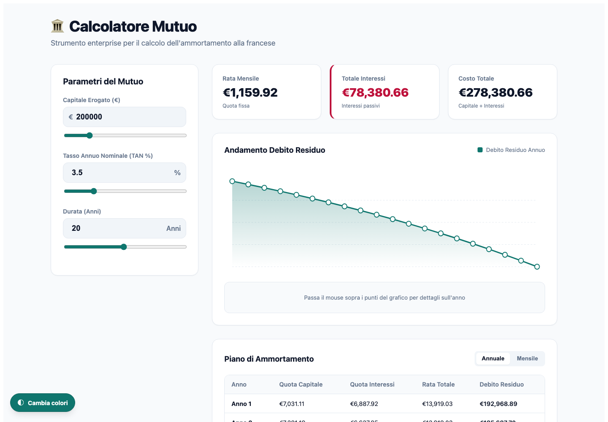
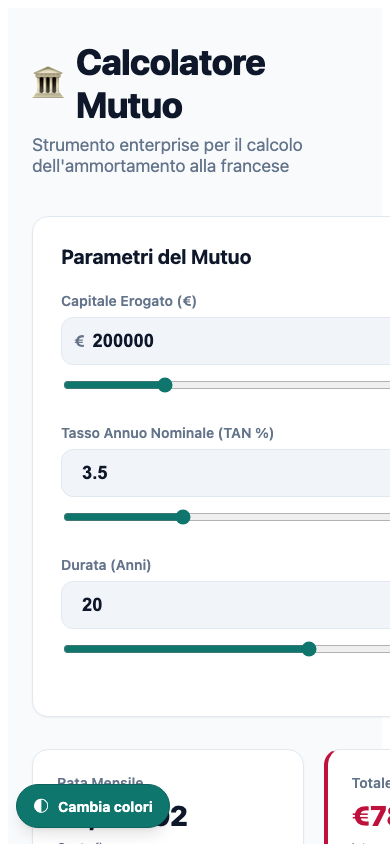

# Calcolatore Mutuo

Applicazione Angular per simulare un piano di ammortamento **alla francese**. Inserendo capitale, TAN e durata, l’interfaccia aggiorna subito rata, costo degli interessi, debito residuo e piano di rimborso, senza inviare dati a servizi esterni.

> **Nota importante:** questa è una simulazione a scopo informativo e formativo. Non sostituisce un preventivo, il PIES o la consulenza di un intermediario. Spese, imposte, assicurazioni, commissioni e TAEG non sono inclusi nel calcolo.

## Indice

- [Panoramica](#panoramica)
- [Guida utente](#guida-utente)
- [Come funziona il calcolo](#come-funziona-il-calcolo)
- [Avvio del progetto](#avvio-del-progetto)
- [Test e build](#test-e-build)
- [Architettura](#architettura)

## Panoramica

Il calcolatore è pensato come dashboard chiara per analizzare un mutuo a tasso fisso. Offre:

- inserimento diretto e slider per capitale, TAN e durata;
- ricalcolo immediato con Angular Signals;
- KPI per rata mensile, interessi complessivi e costo totale;
- grafico interattivo del debito residuo anno per anno;
- piano di ammortamento aggregato per anno o dettagliato per mese;
- palette cromatica alternativa, attivabile dal pulsante fisso in basso a sinistra.

### Vista desktop



### Vista compatta



Le immagini sono state acquisite dalla versione corrente dell’app con i valori iniziali: **200.000 €**, **3,5% TAN** e **20 anni**.

## Guida utente

### 1. Imposta i parametri

Nel riquadro **Parametri del Mutuo** modifica uno o più campi. Puoi digitare il valore oppure usare lo slider subito sotto il campo.

| Parametro | Significato | Intervallo nel campo numerico |
| --- | --- | --- |
| Capitale erogato | Importo finanziato in euro | 1.000 € – 10.000.000 € |
| TAN | Tasso annuo nominale, espresso in percentuale | 0,1% – 20% |
| Durata | Anni di rimborso | 1 – 50 anni |

I cursori hanno intervalli più sintetici per facilitare le simulazioni comuni: 10.000 €–1.000.000 €, 0,1%–15% e 1–40 anni. Per importi o durate fuori da tali limiti usa il campo numerico.

Ogni modifica aggiorna automaticamente tutte le sezioni della dashboard: non c’è un pulsante «Calcola» da premere.

### 2. Leggi i risultati principali

Le tre card in alto mostrano:

- **Rata mensile**: importo costante previsto per ogni rata;
- **Totale interessi**: interessi cumulati nell’intera durata del piano;
- **Costo totale**: capitale finanziato più interessi.

Per esempio, con i valori iniziali l’app calcola una rata di **1.159,92 €**, interessi per **78.380,66 €** e un costo totale di **278.380,66 €**.

### 3. Esplora il grafico

Il grafico **Andamento Debito Residuo** visualizza la riduzione del capitale ancora da rimborsare alla fine di ogni anno. Passa il puntatore su un punto della linea per vedere:

- anno selezionato;
- debito residuo a fine anno;
- interessi pagati nel corso di quell’anno.

### 4. Consulta il piano di ammortamento

Nella sezione **Piano di Ammortamento** usa il selettore in alto a destra:

- **Annuale** raggruppa le dodici rate di ciascun anno;
- **Mensile** mostra ogni singola rata.

Per ogni riga sono disponibili quota capitale, quota interessi, rata totale e debito residuo. All’inizio del piano la quota interessi è più rilevante; procedendo nel tempo aumenta la parte di capitale rimborsata.

### 5. Cambia palette

Il pulsante **Cambia colori**, sempre visibile nell’angolo in basso a sinistra, passa dalla palette verde/ardesia a una variante indaco. Un secondo clic ripristina i colori originali.

## Come funziona il calcolo

Il piano utilizza il metodo di ammortamento francese: la rata resta costante, mentre la sua composizione varia ogni mese. La quota interessi viene calcolata sul debito residuo e la quota capitale è la differenza rispetto alla rata.

Definiti:

- `C` = capitale finanziato;
- `i` = TAN / 100 / 12, cioè il tasso mensile;
- `n` = anni × 12, cioè il numero di rate;

la rata mensile è:

```text
R = C × [i × (1 + i)^n] / [(1 + i)^n − 1]
```

Nel caso di TAN pari a zero, la rata è semplicemente `C / n`. Per ogni mese il servizio aggiorna debito residuo, quota capitale e quota interessi; da queste rate genera anche il riepilogo annuale mostrato dalla UI.

## Avvio del progetto

### Prerequisiti

- [Node.js](https://nodejs.org/) 20.19+ oppure 22.12+;
- npm 11+;
- un browser moderno.

### Installazione e server di sviluppo

```bash
npm ci
npm start
```

Apri quindi [http://localhost:4200](http://localhost:4200). Il server di sviluppo esegue il refresh automatico dopo ogni modifica ai sorgenti.

## Test e build

| Comando | Scopo |
| --- | --- |
| `npm test` | Esegue i test unitari con Vitest. |
| `npx playwright test` | Esegue gli scenari end-to-end con Playwright. Se necessario, installa prima i browser con `npx playwright install`. |
| `npm run build` | Genera bundle browser e server in `dist/my-app/`. |
| `npm run watch` | Compila in modalità sviluppo mantenendo attivo il watch. |

## Architettura

Il progetto usa Angular 22, componenti standalone e TypeScript in modalità strict.

| Area | Responsabilità |
| --- | --- |
| [`src/app/mortgage-calculator.service.ts`](src/app/mortgage-calculator.service.ts) | Formula del mutuo, generazione delle rate mensili e aggregazione annuale. |
| [`src/app/mortgage-calculator/mortgage-calculator.component.ts`](src/app/mortgage-calculator/mortgage-calculator.component.ts) | Stato dell’interfaccia e valori derivati con `signal` e `computed`. |
| [`src/app/mortgage-calculator/mortgage-calculator.component.html`](src/app/mortgage-calculator/mortgage-calculator.component.html) | Form, KPI, grafico SVG e tabella con control flow Angular moderno. |
| [`src/app/mortgage-calculator/mortgage-calculator.component.css`](src/app/mortgage-calculator/mortgage-calculator.component.css) | Design della dashboard, responsività e due palette tramite variabili CSS. |
| [`e2e/mortgage-calculator.spec.ts`](e2e/mortgage-calculator.spec.ts) | Verifiche end-to-end degli aggiornamenti, del selettore tabella e dei tooltip del grafico. |

Non sono necessarie librerie di charting: il grafico è un SVG nativo generato dai dati annuali. Questo mantiene il progetto leggero e rende la visualizzazione coerente con i valori calcolati.

## Limitazioni della simulazione

Il calcolo considera un tasso nominale costante e rate mensili. Non modella tassi variabili, periodi di preammortamento, estinzioni/parziali, surroghe, ritardi di pagamento, spese ricorrenti o costi accessori. Per decisioni economiche reali verifica sempre le condizioni contrattuali e il TAEG applicabile.
